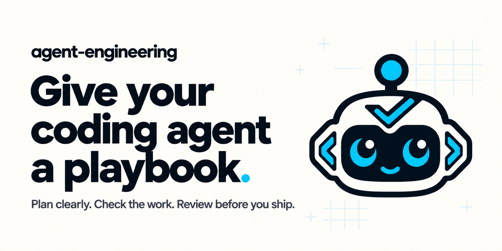

# agent-engineering



[](https://skills.sh/otaviobarros/agent-engineering)
[](https://github.com/otaviobarros/agent-engineering/releases/latest)
[](https://claude.ai/customize/plugins/id/517ccd75-80dc-40e8-87a0-12c977b6b2dc%40anthropic-plugin-directory)
[](#codex-cli-plugin)
[](https://github.com/otaviobarros/agent-engineering/blob/main/LICENSE)

**From “build this” to a reviewed draft PR.**

Your coding agent writes code fast. These fourteen skills make it work like a
careful engineer: it plans before it edits, proves each requirement with a check,
gets an independent review, and stops where you tell it to. Works with Claude Code,
Codex, and any agent the [skills CLI](https://skills.sh) supports.

- **Fewer surprises.** Open product and design decisions come to you before coding.
- **Evidence, not claims.** Each acceptance criterion gets a check result. Missing
  checks and review are reported as gaps, never as passes.
- **A second pair of eyes.** A fresh reviewer that did not write the change checks
  it, and confirmed findings are fixed and reviewed again.
- **Your rules, your limits.** Your project's instructions govern. Commits, pushes,
  PRs, and merges happen only when you authorize them.

## Quick start

**1. Install** all fourteen skills in Claude Code:

```sh
claude plugin marketplace add otaviobarros/agent-engineering
claude plugin install agent-engineering@agent-engineering
```

Other agents and single-skill installs are under [Install](#install).

**2. Teach it your project (recommended, once per repository):**

> Use setup-project to explore this codebase and interview me about gaps and
> improvements. Propose a documentation baseline and default workflow adoption.
> Write accepted docs and instruction references. Preserve our existing standards.

**3. Bring a task:**

> Use deliver-change to show a clear error when the signup email is empty.
> Leave changes uncommitted.

You get a plan, the change with check results, and review findings.

## Start with setup-project for better results

Every skill follows your project's own rules, so results depend on how clearly
those rules are written down. Most repositories keep them in people's heads: which
command runs the tests, where architecture decisions live, which conventions
reviewers enforce. An agent that cannot find them guesses, and you correct the
same mistakes again on every task.

`setup-project` fixes that in one session:

- **Discovers** your code, standards, architecture, and checks, with a low-cost
  discovery agent when available, and checks what it finds.
- **Interviews you** with focused questions and a recommendation for each gap.
- **Writes only what you accept:** project docs and references in `AGENTS.md` or
  `CLAUDE.md`, including whether matching tasks use this workflow by default.

Every later task, from planning to review, reads that guidance. Plans name your
real test commands, checks match your standards, and reviewers judge the change
against your rules, not generic ones.

Setup is optional and never runs on its own. Existing project authorities still
govern, and setup runs no project tests or implementation. Run it again when the
project changes to refresh the guidance.

## Pick the result you need

Each skill works on its own. Name it in your request, or describe the outcome.

| Skill | What you get | Try asking |
|---|---|---|
| `deliver-change` | The full workflow, with your scope and stopping point preserved. | "Implement this issue and open a draft PR." |
| `plan-change` | Clear scope, acceptance criteria, and open decisions before code. | "Plan this feature before you touch code." |
| `implement-change` | Scoped code, tests, and docs from an accepted plan. | "Implement slice 1 of the plan." |
| `verify-change` | What passed, what failed, and what remains unverified. | "Check this branch against the acceptance criteria." |
| `review-change` | Validated findings with impact and evidence. | "Review my changes before I commit." |
| `review-pr` | Prioritized PR threads, a concise summary, and a justified review decision. | "Review PR #42 and post findings." |
| `remediate-findings` | Confirmed defects corrected, verified, and independently reviewed again. | "Fix the confirmed review findings." |
| `respond-to-review` | Each comment on your PR checked against the code, then fixed or answered with evidence. | "Address the review comments on my PR." |
| `diagnose-issue` | A root cause proven by a failing reproduction, and a named regression test for the fix. | "Find out why checkout tests fail on CI." |
| `publish-change` | Authorized commits, push, and a draft PR, with remote effects verified. | "Commit, push, and open a draft PR." |
| `merge-change` | A merge with your chosen method after review, checks, and freshness pass, confirmed on the base branch. | "Squash-merge PR #42 if it is ready." |
| `setup-project` | Codebase discovery, focused questions, and engineering guidance you choose to adopt. | "Set up this repository for agent work." |
| `explain-change` | A visual guide to a PR or branch: what it delivers, its decisions, risks, app impact, and the questions to answer before you approve. | "Explain PR #42 before I approve it." |
| `xray-codebase` | A visual architecture report: hot spots, friction with evidence, and proven patterns such as explicit state machines, with tradeoffs and migration steps. | "X-ray this codebase and suggest improvements." |

## How it works

`deliver-change` runs the phases below in order. Each phase passes its result
to the next one.

1. **Plan** (`plan-change`): acceptance criteria, slices, and the checks for
   each criterion. Open product or design decisions come to you before coding.
2. **Implement** (`implement-change`): the planned edits, tests, and docs for
   one slice.
3. **Verify** (`verify-change`): a result for each criterion, including
   failures and anything left unverified. Steps 2 and 3 repeat for each slice.
4. **Review** (`review-change`): a fresh reviewer who did not write the change
   checks it against your requirements and returns findings with evidence.
   Quick review is the default; experimental deep review requires your explicit
   request.
5. **Remediate** (`remediate-findings`, when needed): confirmed findings are
   fixed, verified again, and reviewed again, for up to three rounds.
6. **Publish** (`publish-change`): only the operations you authorized, such as
   commits, a push, and a draft PR that reports the checks and remaining gaps.

`setup-project` is a separate, optional first step. It records the project
guidance you accept and then stops. Delivery never runs it automatically.
`review-pr`, `respond-to-review`, and `merge-change` cover the rest of the PR
lifecycle. `explain-change` and `xray-codebase` return visual HTML reports.

## Install

Choose one method. The plugin and the skills CLI install the same skills.

### Claude Code plugin

```sh
claude plugin marketplace add otaviobarros/agent-engineering
claude plugin install agent-engineering@agent-engineering
```

The first command registers this repository as a plugin marketplace. The second
installs the `agent-engineering` plugin from it, with all fourteen skills. Update
later with `claude plugin update agent-engineering@agent-engineering`, then
restart Claude Code.

### Codex CLI plugin

```sh
codex plugin marketplace add otaviobarros/agent-engineering
codex plugin add agent-engineering@agent-engineering
```

The commands work the same way as in Claude Code. Refresh later with
`codex plugin marketplace upgrade agent-engineering`.

### Any agent, with the skills CLI

The [skills CLI](https://skills.sh) copies skill folders into your project or
home directory for Claude Code, Codex, Cursor, and other supported agents.

```sh
npx skills add otaviobarros/agent-engineering
```

This lists the fourteen skills and the agents it detects, then asks which to
install. Common options:

| Command | Effect |
|---|---|
| `npx skills add otaviobarros/agent-engineering --all` | Installs every skill for every detected agent, without prompts. |
| `npx skills add otaviobarros/agent-engineering --skill plan-change` | Installs one skill. Repeat `--skill` for more. |
| `npx skills add otaviobarros/agent-engineering -a claude-code` | Installs for one agent only. |
| `npx skills add otaviobarros/agent-engineering -g` | Installs into your home directory for all projects, instead of the current project. |
| `npx skills add otaviobarros/agent-engineering --list` | Lists the skills without installing. |
| `npx skills check` | Reports installed skills that have updates. |
| `npx skills update` | Updates installed skills to the latest release. |

Each skill folder carries the shared references it reads, so a single skill
works on its own. Skills that hand off to another phase, such as `deliver-change`,
name that skill; install it too, or install all fourteen. The skills CLI sends
anonymous install telemetry; set `DISABLE_TELEMETRY=1` to opt out.

## Bring a task. Choose the finish line

**Take an issue to a draft PR.** Replace `ISSUE_URL` with a link, or describe the
change directly.

> Use deliver-change to implement ISSUE_URL. Follow project standards and ask
> about material decisions. Once required checks and independent review pass,
> commit, push, and open a draft PR linked to the issue. Do not merge or deploy.

Plan → implement → verify → independently review → remediate when needed → publish.
The handoff shows what changed, what was checked, findings, and remaining gaps.

**Want to inspect the work first?** Replace the publication request with:

> Leave everything uncommitted for my review. Do not push or create a PR.

**Think it through before touching code.**

> Use plan-change to plan checkout quantity validation. Define scope, acceptance
> criteria, and checks. Return the plan for review before making changes.

**Put useful feedback where the work happens.**

> Use review-pr to review PR #42 and post prioritized findings as threads with a
> summary. Approve only if the required review is complete, current, and clean.
> If that clean result cannot receive formal approval, leave an explicit approval
> comment with the reason. Preserve the code.

**Choose the review depth.** A review is quick by default: one reviewer checks
every area of the change. Changes to authentication or permissions, money, a
database migration, or a public contract such as an API get an extra focused
check in either mode. Diff size does not change the mode.

Ask for a "deep review" to try the experimental mode with up to three reviewers
who split the change by context. Asking for a thorough review alone keeps quick
mode. `review-pr` also defaults to quick; it forwards your explicit mode request.
If a current review of the same PR head already exists, `review-pr` posts it
instead of reviewing again.

Ask for a "quick review" to keep one reviewer. If your agent cannot start other
reviewers, the review runs quick and reports the missing deep reviewers.
Each report states which mode ran, why, and how to ask for the other mode.

Reviews analyze your changes and existing check evidence. Tests run during review
only when you ask. Full delivery still includes verification.

Issue and task links need access through your host's tools. If access is missing,
provide the task text. A link alone does not select a workflow or authorize
tracker comments, status changes, or task closure.

## Execution and data handling

The plugin contains human-readable skills and shared references. It bundles no
executables, hooks, MCP servers, telemetry, or publisher-operated backend.
The agent host executes tools under its own permissions and your authorized scope.
Skills can guide the agent to read and write project files, run tests and shell
commands, and use Git or connected services. This includes reading your project's
requirements and governing instructions.

Project files, Git metadata, and issue or PR content may contain names, usernames,
commit email addresses, or other personal information. Authorized publishing and
review can send code, commits, PR descriptions, and review comments to GitHub or
your configured Git remote through connectors, APIs, or CLI tools. Project checks
may also contact services configured by your project. Review the project's tools
and configuration before authorizing execution.

The HTML reports from `explain-change` and `xray-codebase` are local files. Opening
one loads nothing from the network; diagrams render with a library bundled into
the file.

The publisher receives no agent activity through the plugin itself. Local files,
host transcripts, and remote records have separate storage and retention rules.
Read the [privacy policy](PRIVACY.md) for details and third-party policy links.

## Help and evaluation

Use a supported Codex or Claude Code installation with access to a model and
your working directory. No separate plugin account or subscription is required.
Tests need your project's runtime and dependencies. Git operations need Git;
GitHub operations need an authenticated host tool and access to the target repository.

Try the examples above in a disposable repository with fictional data. Planning
should return a plan; the no-publication variant should leave changes uncommitted.
If you request report-only review, expect findings without posted comments. Verify
the diff, Git history, and host tool actions against your explicit limits.

- Skills missing: check installation and activation in the current host session.
- Shared references missing: reinstall the skill folder with its `references/` directory.
- Commands fail: check the working directory, dependencies, and project check command.
- GitHub unavailable: authenticate your own account or provide the task text locally.
- Independent review unavailable: expect an explicit gap, not a completed-review claim.

For directory evaluation, use a disposable repository and your own host account.
The plugin has no service login or shared testing credentials. Arrange any dedicated
account requirement through the submission contact; do not share production access.

Report ordinary problems through [GitHub Issues](https://github.com/otaviobarros/agent-engineering/issues).
For vulnerabilities, use the private channel in [Security](SECURITY.md).

## About this repository

This repository is a release mirror. The skills are developed, reviewed, and
evaluated with native agent runs in a private development repository. Each
release adds one commit here, so the history shows release snapshots only.

Maintained by Otavio Barros. Follow updates on X: [@obarros](https://x.com/obarros).

## Your project. Your rules

Setup is optional. Existing project authorities remain in place. Each standalone
skill stops at its phase boundary. Limits such as “do not commit” persist across
the workflow and resumed work.

These skills guide agents; the host controls permissions and execution. Missing
required checks or independent review leave dependent delivery incomplete.
Merge, release, deployment, and monitoring require separate authorization.

**Experimental.** Results depend on the model, host capabilities, and project.

[Report an issue](https://github.com/otaviobarros/agent-engineering/issues) ·
[Workflow contract](https://github.com/otaviobarros/agent-engineering/blob/main/skills/deliver-change/references/workflow-contract.md) ·
[MIT License](https://github.com/otaviobarros/agent-engineering/blob/main/LICENSE) ·
[Privacy policy](PRIVACY.md)
