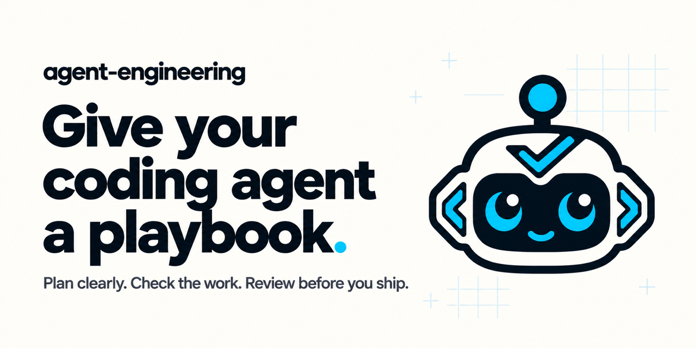

# agent-engineering



**From “build this” to a reviewed draft PR.**

Nine skills for **Codex and Claude Code**. Clear plans. Checks you can inspect.
Independent review. Your project's rules.

Use one skill for the next step, or `deliver-change` for the whole workflow.
**You choose the finish line.**

## Install

**Codex CLI**

```sh
codex plugin marketplace add otaviobarros/agent-engineering
codex plugin add agent-engineering@agent-engineering
```

**Claude Code**

```sh
claude plugin marketplace add otaviobarros/agent-engineering
claude plugin install agent-engineering@agent-engineering
```

Install the complete plugin to keep its shared references. All nine skills can
be invoked independently; copying a single skill folder is not supported.

## Teach it how your project works

**Recommended first step: `setup-project`.** Give your agent a map of your
standards, architecture, checks, and commit/PR conventions. Less repeated context.
A clearer starting point for every change.

> Use setup-project to map this project's standards and workflow. Ask about gaps
> and adoption choices. Save a concise guide and link it from existing agent
> instructions where needed. Preserve our standards.

It reads existing guidance, discusses material gaps and adoption choices, then
creates or refreshes a small project guide, usually `docs/agent-engineering.md`.
Authorized references in `AGENTS.md` or `CLAUDE.md` help later skills find it.
Existing authorities still govern; proposed practices need acceptance.

Setup is optional and does not run automatically on installation.

## Bring a task. Choose the finish line.

**Take an issue to a draft PR.** Replace `ISSUE_URL` with a link, or describe the
change directly.

> Use deliver-change to implement ISSUE_URL. Follow project standards and ask
> about material decisions. Once required checks and independent review pass,
> commit, push, and open a draft PR linked to the issue. Do not merge or deploy.

Plan → implement → verify → independently review → remediate when needed → publish.
The handoff shows what changed, what was checked, findings, and remaining gaps.

**Want to inspect the work first?** Replace the publication request with:

> Leave everything uncommitted for my review. Do not push or create a PR.

**Think it through before touching code.**

> Use plan-change to plan checkout quantity validation. Define scope, acceptance
> criteria, and checks. Return the plan for review before making changes.

**Put useful feedback where the work happens.**

> Use review-pr to review PR #42 and post prioritized findings as threads with a
> summary. Approve only if the required review is complete, current, and clean.
> If that clean result cannot receive formal approval, leave an explicit approval
> comment with the reason. Preserve the code.

Issue and task links need access through your host's tools. If access is missing,
provide the task text. A link alone does not select a workflow or authorize
tracker comments, status changes, or task closure.

## Pick the result you need

| Skill | What you get |
|---|---|
| `setup-project` | Your project's standards, decisions, and checks mapped for the agent. |
| `plan-change` | Clear scope, acceptance criteria, and open decisions before code. |
| `implement-change` | Scoped code, tests, and docs from an accepted plan. |
| `verify-change` | What passed, what failed, and what remains unverified. |
| `review-change` | Validated findings with impact and evidence. |
| `review-pr` | Prioritized PR threads, a concise summary, and a justified review decision. |
| `remediate-findings` | Confirmed defects corrected, verified, and independently reviewed again. |
| `publish-change` | Authorized commits, push, and a draft PR, with remote effects verified. |
| `deliver-change` | The full workflow, with your scope and stopping point preserved. |

## Your project. Your rules.

Setup is optional. Existing project authorities remain in place. Each standalone
skill stops at its phase boundary. Limits such as “do not commit” persist across
the workflow and resumed work.

These skills guide agents; the host controls permissions and execution. Missing
required checks or independent review leave dependent delivery incomplete.
Merge, release, deployment, and monitoring require separate authorization.

**Experimental.** Results depend on the model, host capabilities, and project.

[Report an issue](https://github.com/otaviobarros/agent-engineering/issues) ·
[Workflow contract](https://github.com/otaviobarros/agent-engineering/blob/main/references/workflow-contract.md) ·
[MIT License](https://github.com/otaviobarros/agent-engineering/blob/main/LICENSE)
